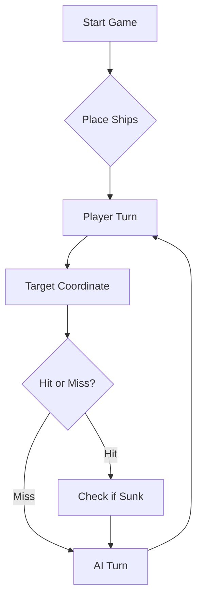

# ⚓ Battleship 2.0


> A modern take on the classic naval warfare game, designed for the XVII century setting with updated software engineering patterns.

---

## Elementos do Grupo

| Curso | Número de Aluno | Nome |
| :--- | :---: | :--- |
| LETI | 129778 | Laura Filipe |
| LETI | 129774 | Teresa Cunha |
| LETI | 129773 | Natalia Hortense |

---

Vídeo user story + LLM: https://youtu.be/4ChOA_-mKiQ

Diário de bordo do LLM:
rajada 1:B3 F7 I4 - 1 caravela atingida, 2 em agua
rajada 2:B4 F8 I5 - 3 em agua 
rajada 3:A3 E7 H4 - 1 caravela afundada, 2 em agua
rajada 4:D2 G9 J6 - 1 Nau atingida, 2 em agua
rajada 5:D3 G10 J7 - 1 Galeão atingido, 2 em agua
rajada 6:D1 G8 J5 - 1 barca afundada, 1 nau atingida, 1 em agua
rajada 7:G7 J4 C3 - 1 Nau afundada, 2 em agua
rajada 8:D4 E3 J8 - 1 Galeão atingido, 2 em agua
rajada 9:D5 F3 J9 - 1 Galeão atingido, 2 em agua
rajada 10:C5 E5 H2 - 3 em agua
rajada 11:F2 F4 F10 - 1 galeão atingido, 2 em agua
rajada 12:E4 A8 H8 - 1 Galeão afundado, 2 em agua
rajada 13:B7 H3 I9 - 1 caravela atingida, 1 nau atingida, 1 em agua
rajada 14:B8 I3 I10 - 3 em agua
rajada 15:B6 A7 I8 - 1 nau atingida, 2 em agua
rajada 16:C7 H9 I7 - 1 Caravela afundada, 1 fragata atingida 1 em agua
rajada 17:G1 C9 A5 - 1 barca afundada 1 fragata atingida 1 em agua
rajada 18:F1 H1 D9 - 1 Caravel atingida, 1 fragata atingida, 1 em agua
rajada 19:B9 E9 E1 - 1 caravela afundada, 1 fragata atingida, 1 em agua
rajada 20:A9 F9 H5 - 1 fragata afundada, 2 em agua
rajada 21:A1 B5 I1 - 3 em agua
rajada 22:B1 I2 J1 - 1 barca afundada, 2 em agua
rajada 23:J2 A1(tiro repetido) A2 - 1 tiro repetido, 2 em agua
rajada 24:J3 F6 G6 - 1 barca afundada, 2 em agua


## 📖 Table of Contents
- [Project Overview](#-project-overview)
- [Key Features](#-key-features)
- [Technical Stack](#-technical-stack)
- [Installation & Setup](#-installation--setup)
- [Code Architecture](#-code-architecture)
- [Roadmap](#-roadmap)
- [Contributing](#-contributing)

---

## 🎯 Project Overview
This project serves as a template and reference for students learning **Object-Oriented Programming (OOP)** and **Software Quality**. It simulates a battleship environment where players must strategically place ships and sink the enemy fleet.

### 🎮 The Rules
The game is played on a grid (typically 10x10). The coordinate system is defined as:

$$(x, y) \in \{0, \dots, 9\} \times \{0, \dots, 9\}$$

Hits are calculated based on the intersection of the shot vector and the ship's bounding box.

---

## ✨ Key Features
| Feature | Description | Status |
| :--- | :--- | :---: |
| **Grid System** | Flexible $N \times N$ board generation. | ✅ |
| **Ship Varieties** | Galleons, Frigates, and Brigantines (XVII Century theme). | ✅ |
| **AI Opponent** | Heuristic-based targeting system. | 🚧 |
| **Network Play** | Socket-based multiplayer. | ❌ |

---

## 🛠 Technical Stack
* **Language:** Java 17
* **Build Tool:** Maven / Gradle
* **Testing:** JUnit 5
* **Logging:** Log4j2

---

## 🚀 Installation & Setup

### Prerequisites
* JDK 17 or higher
* Git

### Step-by-Step
1. **Clone the repository:**
   ```bash
   git clone [https://github.com/britoeabreu/Battleship2.git](https://github.com/britoeabreu/Battleship2.git)
   ```
2. **Navigate to directory:**
   ```bash
   cd Battleship2
   ```
3. **Compile and Run:**
   ```bash
   javac Main.java && java Main
   ```

---

## 📚 Documentation

You can access the generated Javadoc here:

👉 [Battleship2 API Documentation](https://britoeabreu.github.io/Battleship2/)


### Core Logic
```java
public class Ship {
    private String name;
    private int size;
    private boolean isSunk;

    // TODO: Implement damage logic
    public void hit() {
        // Implementation here
    }
}
```

### Design Patterns Used:
- **Strategy Pattern:** For different AI difficulty levels.
- **Observer Pattern:** To update the UI when a ship is hit.
</details>

### Logic Flow


---

## 🗺 Roadmap
- [x] Basic grid implementation
- [x] Ship placement validation
- [ ] Add sound effects (SFX)
- [ ] Implement "Fog of War" mechanic
- [ ] **Multiplayer Integration** (High Priority)

---

## 🧪 Testing
We use high-coverage unit testing to ensure game stability. Run tests using:
```bash
mvn test
```

> [!TIP]
> Use the `-Dtest=ClassName` flag to run specific test suites during development.

---

## 🤝 Contributing
Contributions are what make the open-source community such an amazing place to learn, inspire, and create.

1. Fork the Project
2. Create your Feature Branch (`git checkout -b feature/AmazingFeature`)
3. Commit your Changes (`git commit -m 'Add some AmazingFeature'`)
4. Push to the Branch (`git push origin feature/AmazingFeature`)
5. Open a **Pull Request**

---

## 📄 License
Distributed under the MIT License. See `LICENSE` for more information.

---
**Maintained by:** [@britoeabreu](https://github.com/britoeabreu)  
*Created for the Software Engineering students at ISCTE-IUL.*
